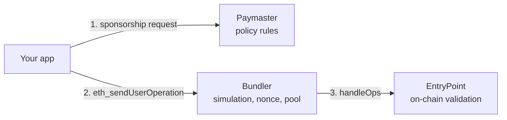

# Errors & troubleshooting

An operation can be refused at three layers. The layer tells you who said no:

A refusal at any of these happens **before** the operation is included, so it costs no gas. An operation
that is included but whose calls revert is not an error: `sendCalls` returns `success: false` with the
transaction hash.

## Paymaster (policy)

JSON-RPC error `-32000` with `data.reason`. The SDK retries the first three by itself.

| `reason` | Meaning | Fix |
| --- | --- | --- |
| `free_exhausted` | Another operation took the last free slot | Retried automatically (now charged in USDC.e) |
| `fee_quote_stale` | The exchange rate moved more than 3% since the quote | Retried automatically |
| `fee_allowance_missing` | Gas was re-estimated above the approved amount | Retried automatically |
| `fee_balance_insufficient` | Not enough USDC.e for the fee — also when the operation itself spends the USDC.e the fee needs | Top up, or send less |
| `would_revert` | Simulation shows the calls would fail | Fix the call (wrong recipient, amount, or permissions) |
| `budget_exceeded` | A monthly, per-user, or daily limit of the policy is reached | Wait for the next period, or ask to raise it |
| `op_cost_exceeded` | This single operation costs more than the policy allows per operation | Split it |
| `policy_required` | No `policyId` was sent | Pass `paymaster: { policyId, anchorId }` |
| `policy_not_found` / `policy_inactive` / `policy_ended` | Unknown, switched off, or expired policy | Check the ID; contact us |
| `anchor_required` / `anchor_unknown` / `not_entitled` | Missing or unknown `anchorId`, or it is not allowed under this policy | Check the anchor your backend sends |
| `sender_blocked` / `anchor_blocked` | Too many failed operations from this account or user | Contact us |
| `action_not_allowed` | The policy only sponsors certain contracts or functions | Check what your policy covers |
| `sponsor_mode_off` | Sponsorship is paused on this network | Send without a paymaster, or retry later |

## Bundler

| Code | Message | Meaning | Fix |
| --- | --- | --- | --- |
| -32602 | `already known` | The same operation is already queued | Wait for it |
| -32505 | `Max operations (4) reached for account` | More than 4 operations from one account in flight | Wait, or [batch](./agent-permissions.mdx#throughput-one-account-one-operation-at-a-time) |
| -32500 | `AA…` (see below) | The EntryPoint rejected it in simulation | See the AA code |
| HTTP 429 | — | Per-IP rate limit on the public endpoint | Back off and retry |

## EntryPoint (AA codes)

| Code | Meaning | Usual cause on HPP |
| --- | --- | --- |
| `AA21 didn't pay prefund` | The account has to pay gas but cannot | No paymaster and no ETH in the account |
| `AA23 reverted` | The account's validation reverted | A session over its limit, wrong contract, revoked, or expired |
| `AA24 signature error` | The account rejected the signature | Wrong owner key, or signed the hash without the EIP-191 prefix (7702 accounts) |
| `AA25 invalid account nonce` | Nonce reused, or the previous operation is not mined yet | Send operations from one account one at a time, or use nonce lanes |
| `AA31 paymaster deposit too low` | The paymaster's deposit cannot cover this operation | Temporary on HPP's side — retry later or contact us |
| `AA33 reverted` / `AA34 signature error` | The paymaster's approval was rejected | The operation was **changed after** the paymaster signed it, or the approval expired (5 min) — request a new one |
| `AA22 expired or not due` / `AA32 …` | Outside the valid time window | Re-sign with a fresh approval |
| `AA40` / `AA41` | Verification gas limit too low or too high | Let the SDK estimate, or re-estimate |

## Troubleshooting

| Symptom | Likely cause | Fix |
| --- | --- | --- |
| Every request fails, or the account address looks wrong | Bundler URL and `chain` point at different networks | Use `aa.hpp.io/rpc` with `hppMainnet`, `aa-sepolia.hpp.io/rpc` with `hppSepolia` |
| `AA34` right after you edit the operation | Any field changed after the paymaster approval invalidates it | Build the operation, get the approval, sign — in that order, without edits |
| Operation accepted, then never mined | Under-priced; dropped from the pool after 300 s | Use `rundler_getUserOperationGasPrice`; keep a `preVerificationGas` buffer (the SDK does both) |
| The 7702 setup transaction succeeded but the account is still a plain EOA | An SDK older than 0.3.2 used the wrong authorization nonce when the account sends its own setup | Upgrade `@hpp-io/aa-sdk` to the latest version and run `ensureReady` again |
| A token (USDC.e) rejects a signature from a delegated account | Tokens call `isValidSignature` on accounts with code | Sign through the account (`user.account.signTypedData`), not the raw owner key |
| A factory-mode account fails on its first operation | Deploying inside the first operation is not supported on HPP | Call `ensureReady` first — it deploys with a normal transaction |
| An agent's payments stopped | Limit used up, permission expired, or revoked | Issue a new permission |

Still stuck? Email [support@hpp.io](mailto:support@hpp.io) with the network, your account address, and the
`userOpHash` or error message.
