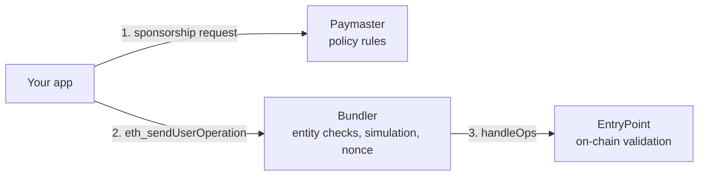

# Errors & troubleshooting

An operation can be refused at three layers. The layer tells you who said no:

A refusal at any of these happens **before** the operation is included, so it costs no gas. An operation
that is included but whose calls revert is not an error: `sendCalls` returns `success: false` with the
transaction hash.

## Paymaster (policy)

Returned from the `pm_*` calls as a JSON-RPC error with `data.reason`. Read it with `paymasterReason(e)`
from `@hpp-io/aa-sdk` (the SDK also throws `HppPaymasterError`, whose `.reason` is the same value). The SDK
retries the first three by itself.

| `reason` | Meaning | Fix |
| --- | --- | --- |
| `free_exhausted` | Another operation took the last free slot | Retried automatically (now charged in USDC.e) |
| `fee_quote_stale` | The exchange rate moved more than 3% since the quote | Retried automatically |
| `fee_allowance_missing` | Gas was re-estimated above the approved amount | Retried automatically |
| `fee_balance_insufficient` | Not enough USDC.e for the fee — also when the operation itself spends the USDC.e the fee needs | Top up, or send less |
| `would_revert` | Simulation shows the calls would fail | Fix the call (recipient, amount, permissions) |
| `anchor_budget_exceeded` | This user's monthly budget under the policy is used up | Wait for next month, or retry without the paymaster |
| `anchor_daily_count_exceeded` | This user's daily number of sponsored operations is used up | Wait until tomorrow, or retry without the paymaster |
| `budget_exceeded` / `count_exceeded` | The policy's overall budget or operation count is used up | Retry without the paymaster; ask us to review the limits |
| `revoke_daily_count_exceeded` | Too many sponsored revokes by this user today | Wait until tomorrow, or revoke without the paymaster |
| `op_cost_exceeded` | This single operation costs more than the policy allows per operation | Split it into smaller operations |
| `policy_required` | No `policyId` was sent | Pass `paymaster: { policyId, anchorId }` |
| `policy_not_found` / `policy_inactive` / `policy_not_started` / `policy_ended` / `policy_archived` | Unknown policy, switched off, before its start, or after its end | Check the ID and dates |
| `anchor_required` / `anchor_unknown` / `anchor_not_entitled` | Missing anchor, an anchor not registered, or not allowed under this policy | Check the anchor your backend sends |
| `action_not_allowed` / `calldata_unrecognized` | The policy only sponsors certain contracts or functions, and this call is not one of them (or could not be decoded) | Check what your policy covers |
| `sender_blocked` / `anchor_blocked` | Too many failed operations from this account or user | Open an issue (see [Help](#help)) |
| `token_mode_unavailable` / `fee_token_not_allowed` / `fee_token_unconfigured` / `fee_price_unavailable` | Gas in USDC.e cannot be offered right now, or the token is not accepted | Retry later; check the token |
| `gas_missing` | The request did not include gas limits | Let the SDK estimate gas first |

## Bundler

| Code / reason | Message | Meaning | Fix |
| --- | --- | --- | --- |
| `unsupported_paymaster` | — | The operation names a paymaster other than HPP's | On HPP, sponsorship goes through HPP's paymaster only |
| `unsupported_factory` | — | The account factory is not on HPP's allowlist (Kernel, SimpleAccount v0.7/v0.8, EIP-7702) | Use a supported account type |
| -32602 | `already known` | The same operation is already queued | Wait for it |
| -32505 | `Max operations (4) reached for account` | More than 4 operations from one account in flight | Wait, or batch calls into one operation |
| — | `unsupported entryPoint` | Sponsorship was requested for an EntryPoint other than v0.7 | Use EntryPoint v0.7 (the SDK default) |
| -32500 | `AA…` | The EntryPoint rejected it in simulation | See the AA codes below |
| HTTP 429 | — | Per-IP rate limit on the public endpoint | Back off and retry |

## EntryPoint (AA codes)

| Code | Meaning | Usual cause on HPP |
| --- | --- | --- |
| `AA21 didn't pay prefund` | The account has to pay gas but cannot | No paymaster and no ETH in the account |
| `AA22 expired or not due` | Outside the account's valid time window | Re-sign |
| `AA23 reverted` / `AA24 signature error` | The account rejected the operation | Wrong owner key; a 7702 account signed without the EIP-191 prefix; or a session outside its rules (over the limit, wrong contract, revoked, expired) |
| `AA25 invalid account nonce` | Nonce reused, or the previous operation is not mined yet | Send one operation at a time per account |
| `AA31 paymaster deposit too low` | The paymaster's deposit cannot cover this operation | Temporary on HPP's side — retry later, or send without the paymaster |
| `AA32 paymaster expired or not due` | The paymaster approval expired (5 minutes) | Request a new approval and send right away |
| `AA33 reverted` / `AA34 signature error` | The paymaster approval does not match the operation | A field was **changed after** the paymaster approved it — request a new approval |
| `AA40` / `AA41` | Verification gas limit too low or too high | Let the SDK estimate, or re-estimate |

## Troubleshooting

| Symptom | Likely cause | Fix |
| --- | --- | --- |
| Every request fails, or the account address looks wrong | Bundler URL and `chain` point at different networks | Use `aa.hpp.io/rpc` with `hppMainnet`, `aa-sepolia.hpp.io/rpc` with `hppSepolia` (`chain` defaults to Sepolia if omitted) |
| `AA34` right after you edit the operation | Any field changed after the paymaster approval invalidates it | Build the operation, get the approval, sign — in that order, without edits |
| Operation accepted, then never mined | Under-priced; dropped from the pool after 300 s | Use `rundler_getUserOperationGasPrice`; keep a `preVerificationGas` buffer (the SDK does both) |
| The 7702 setup transaction succeeded but the account is still a plain EOA | An SDK older than 0.3.2 used the wrong authorization nonce when the account sent its own setup | Upgrade `@hpp-io/aa-sdk` and run `ensureReady` again |
| `embedded owner: signTypedData not provided` | Signing an x402 payment or a delegation needs typed-data signing | Pass `signTypedData` to `toEmbeddedOwner` |
| A token (USDC.e) rejects a signature from a delegated account | Tokens call `isValidSignature` on accounts with code | Sign through the account (`user.account.signTypedData`), not the raw owner key |
| A factory-mode account fails on its first operation | Deploying inside the first operation is not supported on HPP | Call `ensureReady` first — it deploys with a normal transaction |
| An agent's payments stopped | Limit used up, permission expired, or revoked | Issue a new permission |

## Help

- **Developers:** open an issue on [hpp-io/hpp-aa-sdk](https://github.com/hpp-io/hpp-aa-sdk/issues) with the
  network, your account address, and the `userOpHash` or error message. Never post private keys, anchors,
  or policy IDs.
- **Wallet users:** ask in [HPP Telegram](https://t.me/aergoofficial).
