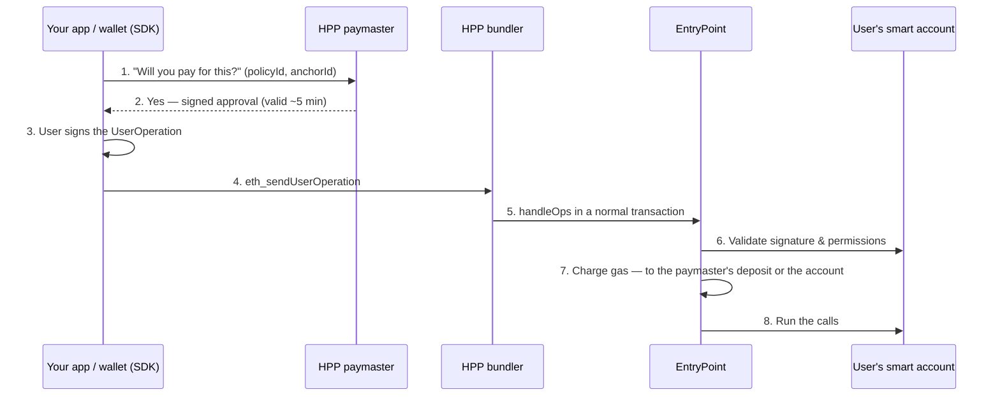

# How it works

## The problem

A normal Ethereum account (an **EOA**) is a private key. The key can do anything, every transaction
costs gas in ETH, and the key is the only way in. That makes three common wishes hard:

- a new user should not need to buy ETH before their first transaction;
- an app or AI agent should be able to act for a user **within limits**, not with full control;
- several steps (approve, then pay) should happen as **one** action.

A **smart account** solves this by making the account a contract. The contract decides what counts as
a valid signature and what is allowed — so rules like "this agent may spend up to 5 USDC.e" or "someone
else pays the gas" become possible.

## The pieces

[ERC-4337](https://eips.ethereum.org/EIPS/eip-4337) adds smart accounts without changing Ethereum
itself. Instead of sending a transaction, the user signs a **UserOperation** — "please run these calls
from my account" — and specialised services take it from there.

| Piece | What it does | On HPP |
| --- | --- | --- |
| **Smart account** | The user's account, as a contract. Checks signatures and permissions, then runs the calls | [Kernel v3.3](https://github.com/zerodevapp/kernel) |
| **UserOperation** | The signed request: which account, which calls, how much gas, who pays | Built and signed by the SDK |
| **Bundler** | Collects UserOperations and submits them to the chain in a normal transaction. It pays the gas up front and is paid back | Run by HPP at `aa.hpp.io/rpc` |
| **EntryPoint** | One shared contract every UserOperation goes through. It enforces the order: validate → charge → run → settle | Standard v0.7 (and v0.8) |
| **Paymaster** | Optionally pays the gas for a UserOperation, if its rules allow — or charges it in a token | Run by HPP, same URL as the bundler |

## One operation, end to end

Steps 1–2 are skipped when the account pays its own gas. If validation fails at step 6, the operation is
dropped before anything runs — for a rejected session or an over-limit request, **nobody pays gas**.

## Same address: EIP-7702

A smart account used to mean a **new** address — the user had to move funds into it.
[EIP-7702](https://eips.ethereum.org/EIPS/eip-7702) lets an existing address *point at* smart-account
code instead. On HPP:

- **Email and embedded-wallet users** (Privy and similar) keep their address. One small setup
  transaction makes it a Kernel smart account. HPP Smart Wallet pays for that transaction.
- **Browser wallets** (MetaMask and similar) do not let apps request this signature yet, so the SDK
  deploys a separate Kernel account with a new address instead (*factory mode*).

Everything after setup works the same in both modes.

## Who pays the gas

| Situation | Who pays | What the user needs |
| --- | --- | --- |
| No paymaster | The account, in ETH | A little ETH at the account |
| A `sponsored` policy | HPP's paymaster | Nothing |
| A `token` policy | The account, in USDC.e, charged after the run | USDC.e |
| A `sponsored_then_token` policy | HPP for the first few operations, then USDC.e | USDC.e after the free ones |

Details: [Gas sponsorship](./gas-sponsorship.mdx).

## Two ways to hand out limited power

| | What it is | Used for |
| --- | --- | --- |
| **Payment delegation** ([ERC-7710](https://eips.ethereum.org/EIPS/eip-7710)) | The account signs a permission for another key, with caps checked on-chain | An AI agent paying x402 services from the user's account |
| **Session** | A key with rules installed on the account | A bot or backend sending its own operations to specific contracts |

Details and security model: [Agent permissions](./agent-permissions.mdx).

## Glossary

| Term | Meaning |
| --- | --- |
| **EOA** | An ordinary account controlled by one private key |
| **Smart account** | An account that is a contract, with its own rules for signatures and permissions |
| **UserOperation** (UserOp) | A signed "run these calls from my account" request, sent to a bundler instead of the chain |
| **Bundler** | Service that submits UserOperations to the chain |
| **EntryPoint** | The shared contract that validates, charges for, and runs every UserOperation |
| **Paymaster** | A contract + service that pays (or charges a token for) a UserOperation's gas |
| **EIP-7702** | Lets an existing address use smart-account code, keeping the same address |
| **`policyId`** | Your app's sponsorship rules, issued by HPP |
| **`anchorId`** | One user of your app, as your backend identifies them; sponsorship limits count per anchor |
| **Fee mode** | `sponsored`, `token`, or `sponsored_then_token` — who pays the gas under a policy |
| **Payment delegation** | A capped, revocable permission for another key to pay from the account (ERC-7710) |
| **Session** | A key with rules (contracts, amounts, time) installed on the account |
| **USDC.e** | Bridged USDC on HPP — the token for payments and token-mode gas |
