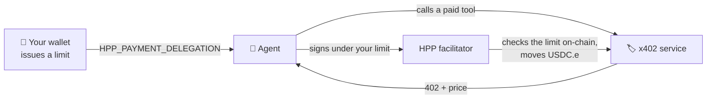

# Pay from an agent with your wallet

[Pay from an AI agent](/x402/agents) gives an agent its own small wallet that you fund. This page shows
the other way: the agent pays **from your HPP Smart Wallet**, under a limit you set there. The agent's key
holds nothing, and one click in the wallet stops it.



| | Agent's own wallet ([x402 guide](/x402/agents)) | Pay from your wallet (this page) |
| --- | --- | --- |
| Where the money is | In the agent's key — you fund it | In your smart wallet |
| What limits the agent | What you funded | A limit, an expiry, and per-payment checks — **on-chain** |
| Stopping it | Move the funds out | **Revoke** in the wallet, effective immediately |
| Works with | Any x402 service | Services settled by the HPP facilitator (they list `erc7710`) |

## Requirements

- An [HPP Smart Wallet](./wallet.mdx) account with some USDC.e
- The `hpp-x402` tool — steps 1 and 2 of [Pay from an AI agent](/x402/agents) (install, then
  `hpp-x402 setup --install <host>`)

## 1. Get the agent's address

```bash
hpp-x402 wallet address
```

This is the agent's own key, kept in your OS keychain. It does not need any USDC.e or ETH for this mode.

## 2. Issue a limit in the wallet

In the wallet, open **Agents → Add agent**:

1. **Name** it (e.g. *Claude on my laptop*) and paste the **agent's address** from step 1.
2. Set the **Limit (USDC.e)** — the most it may spend in total — and the **Duration**.
3. Keep **Pay x402 services** selected and choose **Issue (one signature)**.
4. Copy the **HPP_PAYMENT_DELEGATION** value.


## 3. Add it to your agent host

Add two values to the `hpp-x402` entry in your host's MCP configuration — `HPP_NETWORK` picks the network
your wallet is on, `HPP_PAYMENT_DELEGATION` is the value you copied:

```json title="claude_desktop_config.json (Claude Desktop) — other hosts use the same env block"
{
  "mcpServers": {
    "hpp-x402": {
      "command": "npx",
      "args": ["-y", "@hpp-io/x402-mcp-bridge"],
      "env": {
        "HPP_NETWORK": "eip155:190415",
        "HPP_PAYMENT_DELEGATION": "0x…"
      }
    }
  }
}
```

Use `eip155:181228` for the Sepolia wallet. Restart the host. The bridge checks the value when it starts.

## 4. Let the agent pay

Ask your agent for something that costs money:

> **“Screen 0x1234…abcd against the OFAC sanctions list.”**

The agent finds the service, sees the price, and pays — from your wallet. The payment shows up in the
wallet's **Activity** as an agent payment, and the agent's own key still holds nothing.

## What the limits guarantee

Every payment is checked by the chain, not by HPP's servers:

- the **total** the agent has spent stays within your limit, and the permission **expires** when you said;
- each payment moves **exactly the quoted amount** to **exactly the seller's address**;
- only the HPP facilitator can redeem it, and each signed payment is valid for a short time.

So the limits hold even if the agent is compromised or misbehaves.

## Revoke

In the wallet, open **Agents** and choose **Revoke** on the agent. It takes effect immediately and costs
nothing. Any payment the agent tries afterwards fails.

## Troubleshooting

| Symptom | What to check |
| --- | --- |
| The bridge does not start after adding the value | The value was cut off when copying, or it was issued on the other network — check `HPP_NETWORK` |
| A service is not paid from the wallet | The service does not accept `erc7710` (it is not settled by the HPP facilitator). The agent falls back to its own key, which holds nothing, so the call is not paid |
| Payments stopped | The limit is used up or the permission expired — issue a new one in **Agents** |
