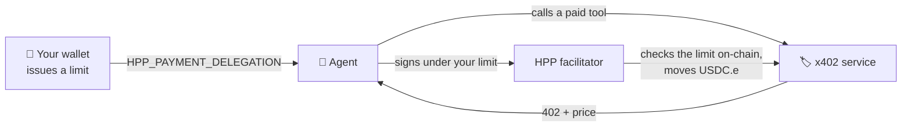

# Pay from an agent with your wallet

:::note[For technical users]
This setup uses a terminal once. You need **Node.js 20+** and an MCP host such as Claude Desktop, Claude
Code, Cursor, Windsurf, or OpenClaw.
:::

[Pay from an AI agent](/x402/agents) gives an agent its own small wallet that you fund. This page shows
the other way: the agent pays **from your HPP Smart Wallet**, under a limit you set there. The agent's key
holds nothing, and one click in the wallet stops it.



| | Agent's own wallet ([x402 guide](/x402/agents)) | Pay from your wallet (this page) |
| --- | --- | --- |
| Where the money is | In the agent's key — you fund it | In your smart wallet |
| What limits the agent | What you funded | A limit, an expiry, and per-payment checks — **on-chain** |
| Stopping it | Move the funds out | **Revoke** in the wallet, effective immediately |
| Works with | Any x402 service | Services settled by the HPP facilitator (they list `erc7710`) |

## Requirements

- An [HPP Smart Wallet](./wallet.mdx) account with some USDC.e
- The `hpp-x402` tool — steps 1 and 2 of [Pay from an AI agent](/x402/agents) (install, then
  `hpp-x402 setup --install <host>`)

## 1. Get the agent's address

```bash
hpp-x402 wallet address
```

This is the agent's own key, kept in your OS keychain. It does not need any USDC.e or ETH for this mode.

## 2. Issue a limit in the wallet

In the wallet, open **Agents → Add agent**:

1. **Name** it (e.g. *Claude on my laptop*) and paste the **agent's address** from step 1.
2. Set the **Limit (USDC.e)** — the most it may spend in total — and the **Duration**.
3. Keep **Pay x402 services** selected and choose **Issue (one signature)**.
4. The wallet opens **Connect**: pick your AI app and copy the command it shows.


## 3. Run the command where the agent runs

Paste the command into a terminal on the computer where the agent's key lives (the one that printed the
address in step 1). It looks like this, with the value filled in:

```bash
npx -y -p @hpp-io/x402-mcp-bridge@latest hpp-x402 install claude-code -n eip155:190415 --delegation 0x…
```

It writes the value into the app's MCP configuration and checks, before writing, that the value belongs to
this key on this network. The bridge checks it again every time it starts, so a value issued on the other
network, revoked, or expired stops the bridge with the reason instead of failing on the first payment.

Restart the app. That is all.

<details>
<summary>Editing the configuration by hand</summary>

The wallet's **Manual** tab shows the same thing as a configuration block. Add `HPP_NETWORK` and
`HPP_PAYMENT_DELEGATION` to the `env` of the `hpp-x402` entry that `hpp-x402 setup --install <host>`
created — for Claude Desktop that file is `~/Library/Application Support/Claude/claude_desktop_config.json`
on macOS and `%APPDATA%\Claude\claude_desktop_config.json` on Windows:

```json
{
  "mcpServers": {
    "hpp-x402": {
      "command": "npx",
      "args": ["-y", "@hpp-io/x402-mcp-bridge"],
      "env": {
        "HPP_NETWORK": "eip155:190415",
        "HPP_PAYMENT_DELEGATION": "0x…"
      }
    }
  }
}
```

Use `eip155:181228` for the Sepolia wallet.

</details>

Keep a copy of the value somewhere safe: you need it to revoke this agent from another device. It can
only be used by the agent's key, within the limit, until the expiry — but it does end up in your shell
history, so treat it like a card with a spending cap.

## 4. Let the agent pay

Ask your agent for something that costs money:

> **“Screen 0x1234…abcd against the OFAC sanctions list.”**

The agent finds the service, sees the price, and pays — from your wallet. The payment shows up in the
wallet's **Activity** as an agent payment, and the agent's own key still holds nothing.

## What the limits guarantee

Every payment is checked by the chain, not by HPP's servers:

- the **total** the agent has spent stays within your limit, and the permission **expires** when you said;
- each payment moves **exactly the quoted amount** to **exactly the seller's address**;
- only the HPP facilitator can redeem it, and each signed payment is valid for a short time.

So the limits hold even if the agent misbehaves. The value you paste is not enough to spend on its own —
it also needs the agent's key, which stays in your OS keychain. If that key is ever exposed, revoke the
permission. Full details: [security model](./agent-permissions.mdx#security-model-of-payment-delegations).

## Revoke

In the wallet, open **Agents** and choose **Revoke** on the agent. It is one operation, usually effective
within seconds, and HPP normally covers its fee. Any payment the agent tries afterwards fails. Then remove
`HPP_PAYMENT_DELEGATION` from the host's configuration.

## Troubleshooting

| Symptom | What to check |
| --- | --- |
| `install --delegation` says the delegation is for another key | The wallet issued it to a different address than this machine's key. Check `hpp-x402 wallet address`; if the key is stored under another keychain account, add `-a <name>` (the wallet's Connect screen has a field for it) |
| …says the paying account is not set up on this network | The value was issued by the wallet on the other network (Sepolia ↔ Mainnet). Re-run with the matching `-n`, or issue one from the right wallet |
| …says the delegation expired or was revoked | Issue a new one in **Agents** and run the new command |
| The bridge does not start after editing the file by hand | The value was cut off when copying, or `HPP_NETWORK` does not match the wallet it came from |
| The agent pays from its own key, or the bridge's start-up log shows an old version | An older global install shadows `npx -y @hpp-io/x402-mcp-bridge`. Run `npm i -g @hpp-io/x402-mcp-bridge@latest` (or uninstall the global copy) and restart the host |
| A service is not paid from the wallet | The service does not accept `erc7710` (it is not settled by the HPP facilitator). The agent falls back to its own key, which holds nothing, so the call is not paid |
| Payments stopped | The limit is used up or the permission expired — issue a new one in **Agents** |
